# Redmine Logtime

App cho macOS và Ubuntu: xem giờ đã log theo lịch tháng, ghi logtime từ báo cáo công việc và xin nghỉ phép trên Redmine. App chỉ ghi lên Redmine sau khi bạn bấm **Ghi ngay** trong popup xác nhận.

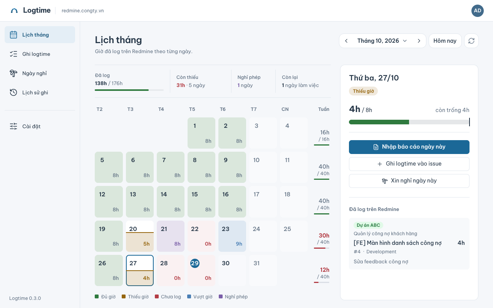

Chọn một ngày để xem đã log gì: dự án, task cha, task và số giờ. Ngày đã đủ giờ chỉ xem, không ghi thêm được.

## Cài đặt

Mở Terminal, chạy:

```bash
curl -fsSL https://raw.githubusercontent.com/tyha2404/redmine-logtime/HEAD/scripts/install.sh | bash
```

Hỗ trợ macOS 11+ (Intel và Apple Silicon) và Ubuntu 22.04+ (`amd64`). Ubuntu sẽ hỏi mật khẩu máy; nếu chưa có `curl`: `sudo apt install -y curl`.

Mở **Redmine Logtime**, nhập địa chỉ Redmine và API key (trên Redmine: **Tài khoản của tôi → API access key → Hiện**) → **Kết nối và mở lịch**. Kiểm tra giờ mỗi ngày, ngày làm việc và ngày lễ trong **Cài đặt → Lịch & nghỉ phép**.

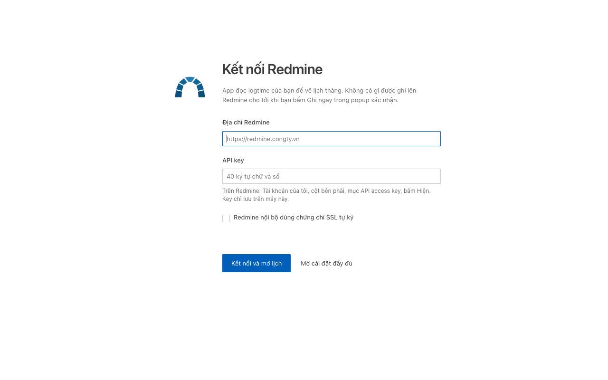

## Ghi logtime từ báo cáo

Cần [Claude CLI](https://claude.ai/install.sh) và [uv](https://docs.astral.sh/uv/): chạy `claude` trong Terminal để đăng nhập, rồi **Cài đặt → Ghi giờ & AI → Chạy thử Claude** và **Phân tích cấu trúc Redmine**.

**1.** Vào **Ghi logtime**, dán báo cáo (hoặc **Lấy từ Google Chat**) → **Phân tích bằng AI**.

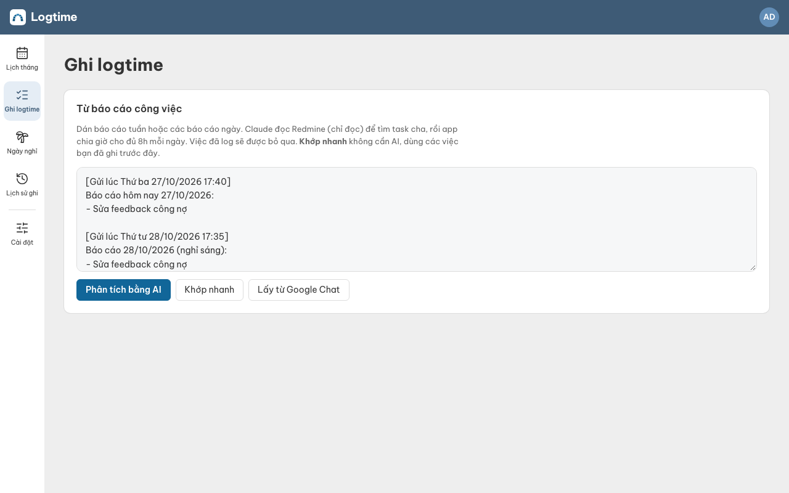

**2.** Kiểm tra kết quả theo từng ngày: bỏ tick việc không ghi, sửa số giờ ở ô bên phải.

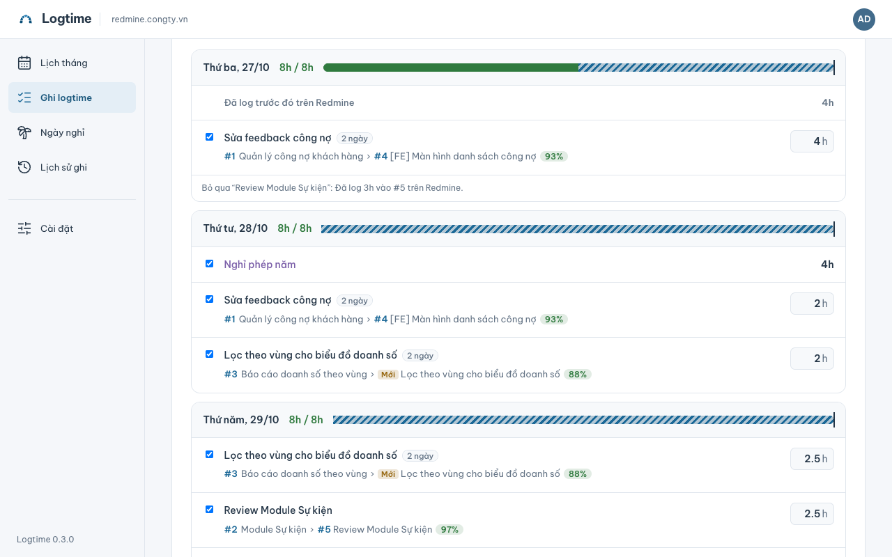

Bấm dòng **task cha › task con** dưới tên việc để đổi task; thay đổi áp dụng cho việc đó ở mọi ngày.

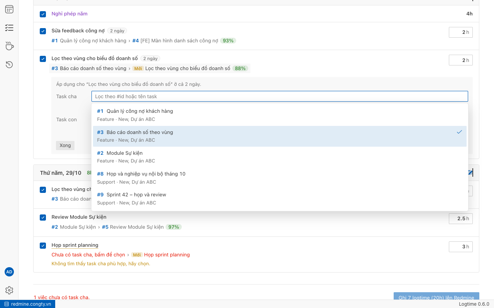

**3.** Bấm **Ghi … lên Redmine**, xem lại những gì sẽ tạo (có task con mới thì tick ô xác nhận) → **Ghi ngay**.

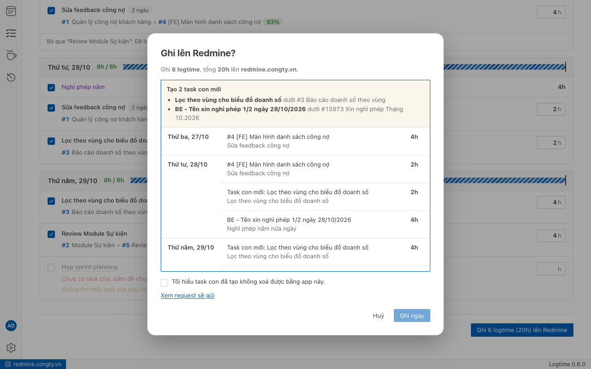

Popup hiện từng mục đã ghi. Ghi nhầm thì bấm **Hoàn tác lô này**; mục lỗi có nút **Thử lại phần lỗi**.

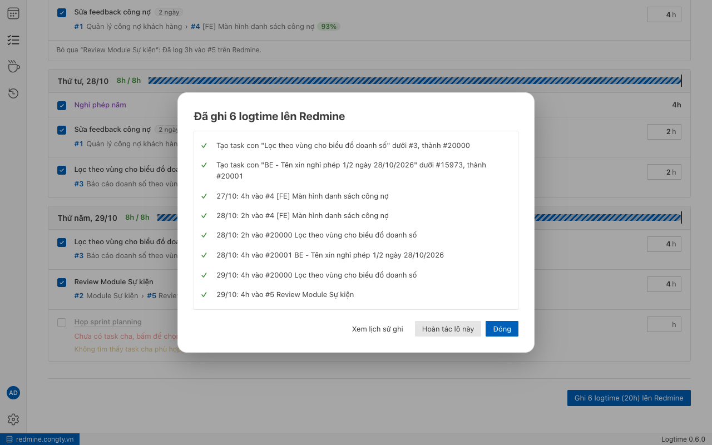

**Khớp nhanh:** app nhớ task bạn đã chọn. Lần sau bấm **Khớp nhanh** để khớp các việc quen mà không cần AI; dòng chưa gặp được liệt kê để dùng AI.

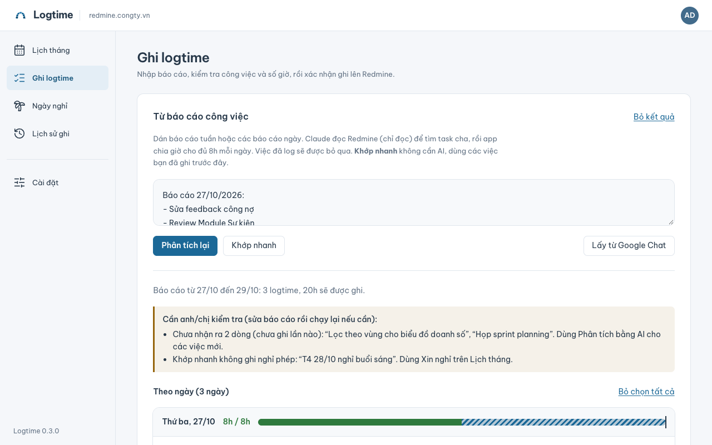

**Điền các ngày thiếu:** trên **Lịch tháng**, bấm **Điền N ngày thiếu**. App lấy tin Google Chat của các ngày thiếu giờ (và sáng hôm sau), chạy **Khớp nhanh** rồi hiện kết quả để duyệt và ghi một lần. Ngày không có tin nào được liệt kê để bạn tự nhập.

## Việc khác

**Ghi tay:** **Lịch tháng** → chọn ngày còn thiếu giờ → **Ghi logtime vào issue**.

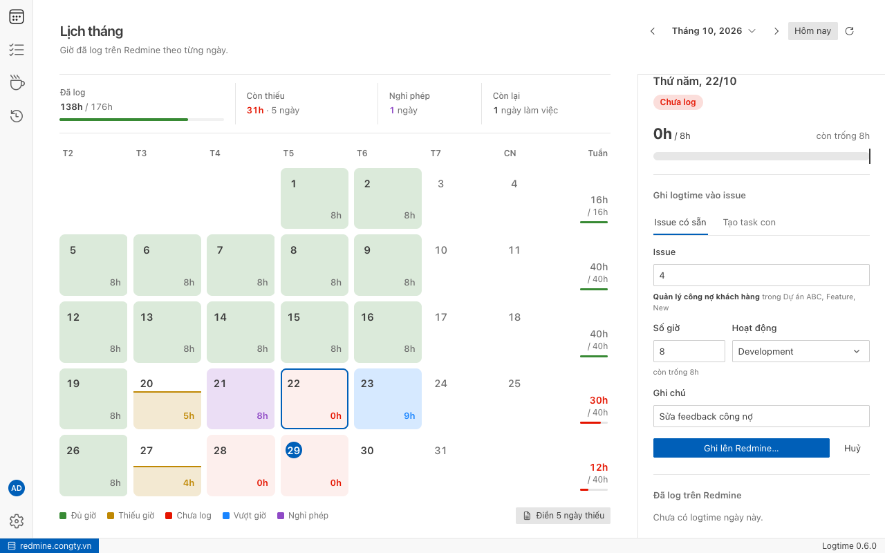

**Xin nghỉ:** lần đầu vào **Cài đặt → Lịch & nghỉ phép → Nghỉ phép → Tìm trên Redmine** → **Lưu cài đặt**. Sau đó **Lịch tháng** → chọn ngày làm việc → **Xin nghỉ ngày này**. Xem số ngày nghỉ còn lại ở trang **Ngày nghỉ**.

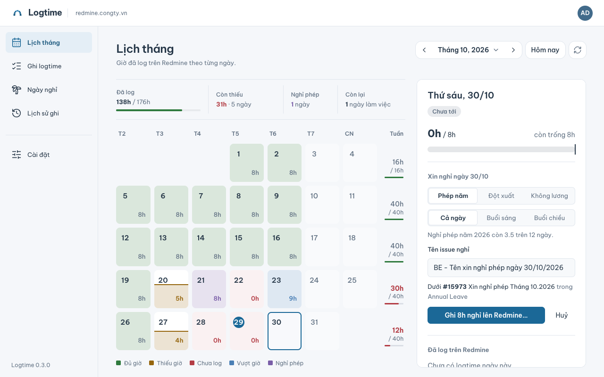

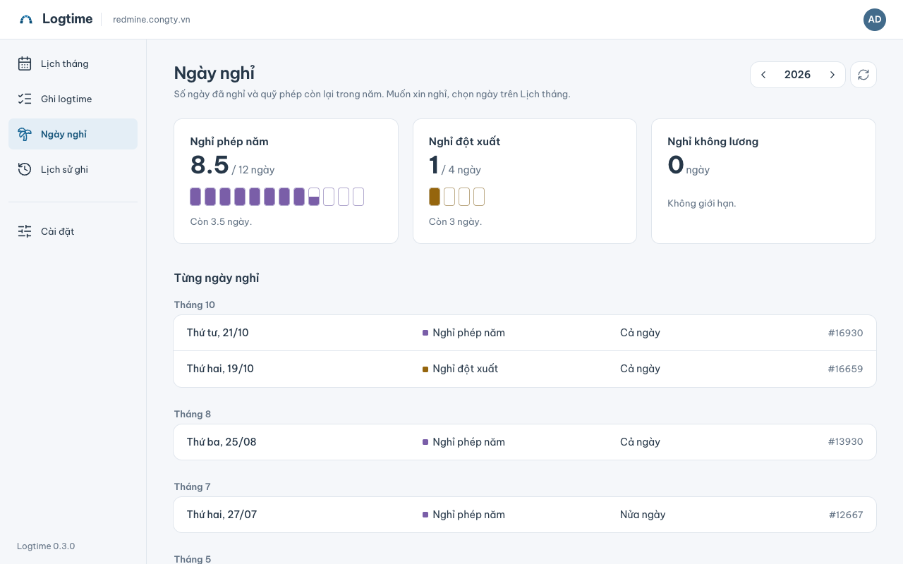

**Lịch sử, hoàn tác:** trang **Lịch sử ghi** liệt kê mọi lần ghi; **Hoàn tác lô này** chỉ xoá logtime, task con vẫn giữ.

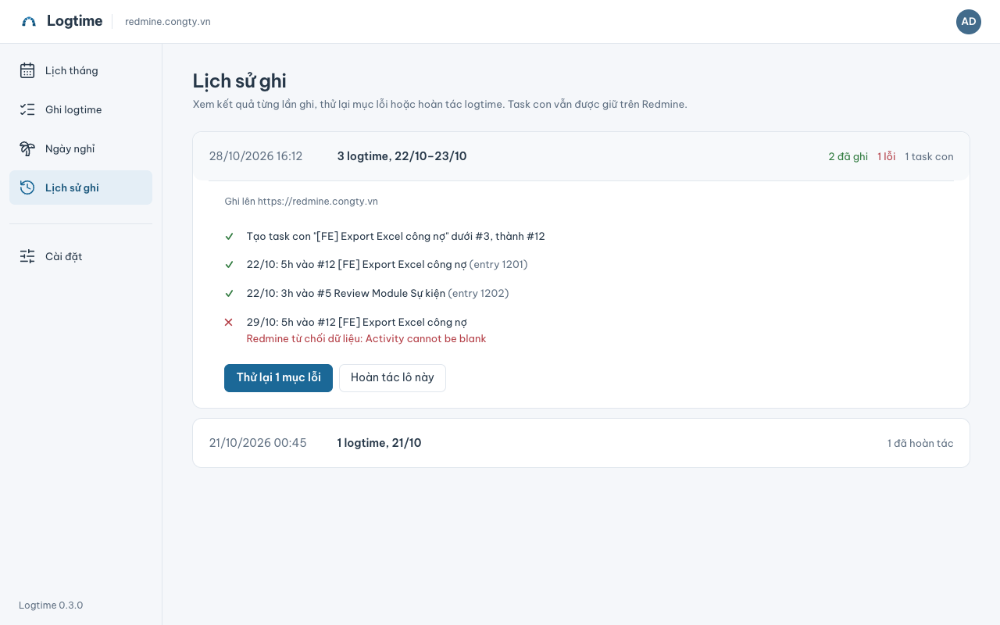

**Nhắc log giờ:** 17:30 ngày làm việc, app báo nếu thiếu giờ. Đóng cửa sổ thì app ẩn xuống thanh menu/khay; chọn **Thoát** ở biểu tượng app để tắt. Đổi trong **Cài đặt → Ứng dụng → Nhắc log giờ**.

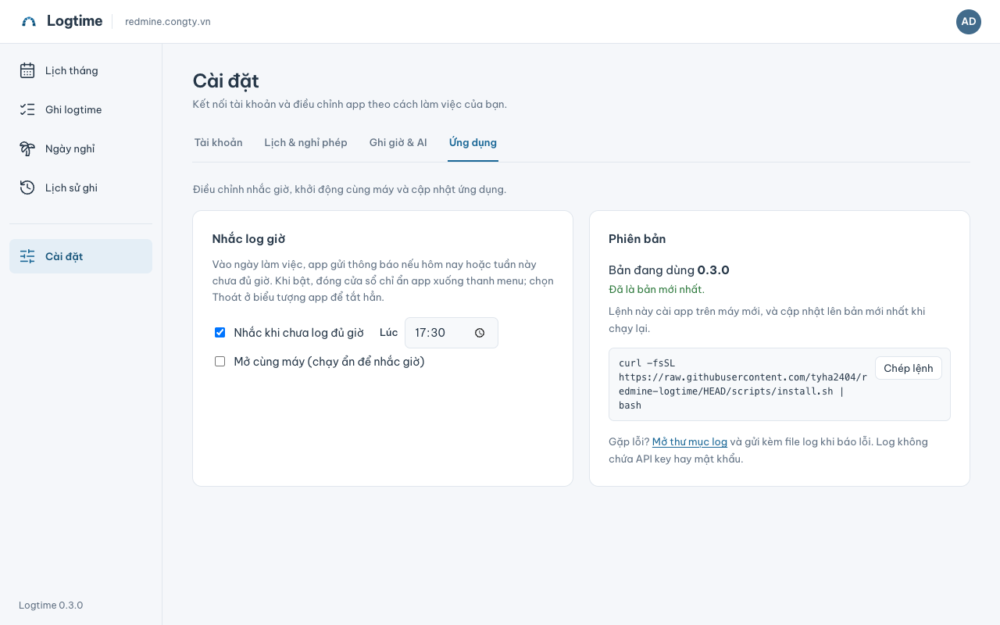

**Biểu tượng trên thanh menu/khay:** menu cho xem giờ hôm nay và trong tuần, có **Ghi logtime hôm nay…** và **Khớp nhanh từ Google Chat**, mở app ở ngày hôm nay. App vẫn hỏi xác nhận trước khi ghi.

**Google Chat:** cần Client ID/secret từ admin công ty ([hướng dẫn admin](docs/development.md#google-chat)), nhập ở **Cài đặt → Tài khoản → Google Chat → Kết nối Google**. App chỉ đọc tin bạn gửi.

## Cập nhật, gỡ cài đặt

- **Cập nhật:** app tự kiểm tra bản mới khi mở và vài giờ một lần; muốn kiểm tra ngay thì bấm **Kiểm tra bản cập nhật** ở **Cài đặt → Ứng dụng → Phiên bản**. Khi có bản mới, bấm biểu tượng tải xuống có chấm đỏ ở góc trên → **Cập nhật và khởi động lại**. Nếu không được, chạy lại lệnh cài đặt.
- **Gỡ:** `curl -fsSL https://raw.githubusercontent.com/tyha2404/redmine-logtime/HEAD/scripts/install.sh | bash -s -- --uninstall`. Cài đặt và API key vẫn giữ trên máy; logtime trên Redmine không bị xoá.

## Khi gặp lỗi

- **Không kết nối được:** kiểm tra địa chỉ, API key, mạng/VPN. Redmine nội bộ dùng SSL tự ký: bật **Chấp nhận chứng chỉ SSL tự ký** trong **Cài đặt**.
- **AI lỗi:** đăng nhập lại `claude`, rồi **Cài đặt → Ghi giờ & AI → Chạy thử Claude**.
- **macOS hỏi quyền Keychain** (nơi lưu API key) sau khi cập nhật: chọn **Luôn cho phép**.
- **Báo lỗi:** **Cài đặt → Ứng dụng → Mở thư mục log**, gửi kèm file log (không chứa API key).

---

Người đóng góp: [Hướng dẫn phát triển](docs/development.md) · [Quy ước](AGENTS.md). Mã nguồn theo giấy phép [MIT](LICENSE). Logo dựa trên [logo Redmine](https://www.redmine.org/projects/redmine/wiki/Logo) © 2009 Martin Herr, đổi màu, theo giấy phép [CC BY-SA 2.5](https://creativecommons.org/licenses/by-sa/2.5/). Redmine Logtime không phải sản phẩm chính thức của Redmine.
