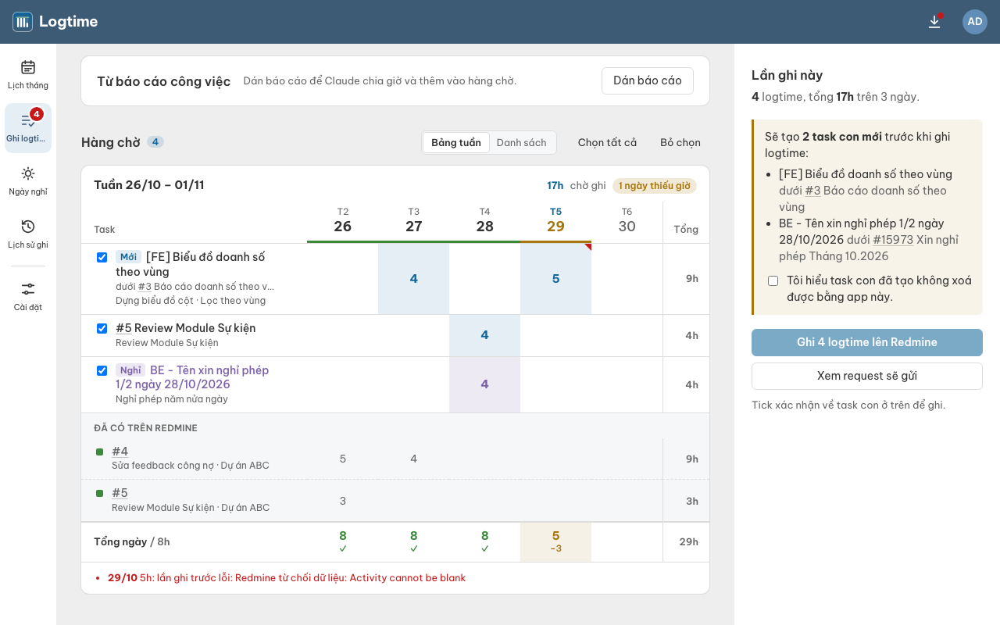

# Redmine Logtime

Ứng dụng cho macOS và Ubuntu giúp xem giờ làm việc, ghi giờ vào công việc (issue) và tạo yêu cầu nghỉ phép trên Redmine.

**Mọi mục đều được đưa vào hàng chờ để kiểm tra. App chỉ ghi lên Redmine khi bạn xác nhận.**

## 1. Cài đặt

### macOS

Hỗ trợ máy Mac dùng chip Intel và Apple Silicon, macOS 11 trở lên.

1. Mở **Terminal** bằng Spotlight (`⌘ Space`, gõ `Terminal`).
2. Dán lệnh sau, nhấn Enter và chờ báo **Đã cài**:

   ```bash
   curl -fsSL https://raw.githubusercontent.com/tyha2404/redmine-logtime/HEAD/scripts/install.sh | bash
   ```

3. Mở **Redmine Logtime** bằng Spotlight hoặc trong thư mục **Applications**.

### Ubuntu

Bản cài sẵn dành cho máy Intel/AMD 64-bit (`amd64`), được build trên Ubuntu 22.04.

1. Mở **Terminal** (`Ctrl Alt T`). Nếu máy chưa có `curl`, chạy:

   ```bash
   sudo apt update && sudo apt install -y curl
   ```

2. Cài app bằng lệnh:

   ```bash
   curl -fsSL https://raw.githubusercontent.com/tyha2404/redmine-logtime/HEAD/scripts/install.sh | bash
   ```

3. Nhập mật khẩu máy nếu được hỏi (khi gõ sẽ không hiện ký tự). Cài xong, mở **Redmine Logtime** từ menu ứng dụng.

Nếu trình cài báo chưa có bản build sẵn và chuyển sang build từ mã nguồn, cần thêm Node.js 22, Rust và công cụ build. Xem [cách chuẩn bị môi trường](docs/development.md#chuẩn-bị-môi-trường).

## 2. Kết nối lần đầu

1. Trên Redmine, vào **Tài khoản của tôi → API access key → Hiện** để sao chép API key.
2. Mở app, nhập **Địa chỉ Redmine** của công ty và **API key**.
3. Bấm **Kết nối và mở lịch**.

API key được lưu trên máy của bạn; không chia sẻ key cho người khác. Nếu không thấy mục API access key, nhờ quản trị viên Redmine hỗ trợ.

Trong **Cài đặt → Ngày làm việc**, kiểm tra số giờ mỗi ngày, ngày làm việc và ngày lễ, rồi bấm **Lưu cài đặt**.


## 3. Sử dụng hằng ngày

### Ghi giờ làm việc

1. Trên **Lịch tháng**, chọn ngày → **Thêm logtime vào issue**.
2. Chọn issue có sẵn hoặc tạo task con mới, điền nội dung và số giờ, rồi thêm vào hàng chờ.
3. Mở **Ghi logtime → Hàng chờ**, kiểm tra công việc và số giờ từng ngày. Bấm ô để sửa giờ; nhập `0` để bỏ. Bỏ tick các mục chưa muốn ghi.
4. Bấm **Ghi N logtime lên Redmine**, kiểm tra lại rồi bấm **Ghi ngay**.

Mục ghi lỗi sẽ quay lại hàng chờ để bạn xử lý.



### Xin nghỉ phép

Lần đầu: vào **Cài đặt → Nghỉ phép → Tìm trên Redmine**, kiểm tra loại nghỉ và tên của bạn, rồi bấm **Lưu cài đặt**.

Sau đó, chọn ngày trên **Lịch tháng → Xin nghỉ ngày này**, điền thông tin và thêm vào hàng chờ. Kiểm tra và ghi như khi ghi giờ làm việc. Nếu không tìm thấy task cha nghỉ phép của tháng, liên hệ HR.

### Nhập báo cáo bằng AI (tùy chọn)

Bạn có thể ghi giờ thủ công mà không cần AI. Để dùng AI:

1. Cài [Claude CLI](https://claude.ai/install.sh) và [uv](https://docs.astral.sh/uv/), rồi mở Terminal, chạy `claude` và đăng nhập theo hướng dẫn.
2. Trong **Cài đặt**, bấm **Chạy thử Claude**. Nên chạy **Phân tích cấu trúc Redmine** trước lần sử dụng đầu tiên.
3. Vào **Ghi logtime**, dán báo cáo có ngày và nội dung công việc → **Phân tích bằng AI**.
4. Kiểm tra issue và giờ được đề xuất → **Thêm vào hàng chờ**, rồi duyệt và ghi như trên.

AI chỉ đọc Redmine để đề xuất công việc; bạn quyết định các mục sẽ ghi.

### Hoàn tác khi ghi nhầm

Vào **Lịch sử ghi → Hoàn tác lô này**. Thao tác này xóa các logtime đã tạo trong lô; **task con vẫn được giữ trên Redmine**.

## 4. Cập nhật và gỡ cài đặt

### Cập nhật lên bản mới

Khi có bản mới, biểu tượng tải xuống ở góc trên app có chấm đỏ.

1. Đóng app.
2. Mở Terminal, chạy **đúng lệnh cài đặt** (giống lúc cài lần đầu):

   ```bash
   curl -fsSL https://raw.githubusercontent.com/tyha2404/redmine-logtime/HEAD/scripts/install.sh | bash
   ```

3. Mở lại app. Cài đặt, API key và hàng chờ được giữ nguyên.

Nếu máy đã là bản mới nhất, lệnh báo vậy và không làm gì thêm.

### Gỡ app

Mở Terminal và chạy lệnh dưới. Lệnh này giống lệnh cài đặt, chỉ thêm `-s -- --uninstall` ở cuối:

```bash
curl -fsSL https://raw.githubusercontent.com/tyha2404/redmine-logtime/HEAD/scripts/install.sh | bash -s -- --uninstall
```

Cài đặt, API key, hàng chờ và lịch sử vẫn được giữ trên máy để dùng khi cài lại. Gỡ app không xóa logtime đã ghi trên Redmine.

## 5. Khi gặp lỗi

- **Không kết nối được Redmine:** kiểm tra địa chỉ, API key và kết nối mạng/VPN của công ty.
- **Redmine nội bộ dùng SSL tự ký:** chọn mục tương ứng ở màn kết nối, hoặc **Cài đặt → Kết nối Redmine → Chấp nhận chứng chỉ SSL tự ký** nếu công ty dùng loại chứng chỉ này.
- **macOS chặn app tải bằng trình duyệt:** thử cài lại bằng lệnh Terminal ở trên.
- **AI báo lỗi:** kiểm tra đã đăng nhập Claude, rồi vào **Cài đặt → Chạy thử Claude**.

---

Dành cho người đóng góp: [Hướng dẫn phát triển](docs/development.md) · [Quy ước đóng góp](AGENTS.md). Giấy phép: [MIT](LICENSE).
